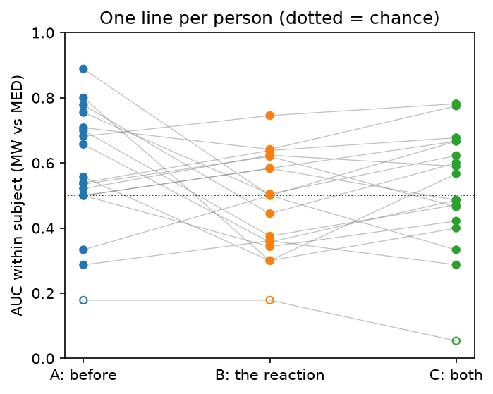

# Results (stage 3, confirmatory)

The analysis was frozen in [PREREG.md](PREREG.md) (commit `2cf0b6b`) before this run.

- **Data:** 490 probes from 22 subjects; 221 mind wandering, 269 meditating.
- **Validation:** leave-one-subject-out.
- **Permutation tests:** 1,000 within-subject shuffles per model.

| Model | Features | Within-subject AUC | 95% CI | p (perm) | Pooled AUC | Balanced acc. |
|---|---|---|---|---|---|---|
| A: before the probe | 192 | **0.597** | 0.516–0.661 | **0.021** | 0.554 | 0.560 |
| B: reaction to the probe | 320 | 0.487 | 0.412–0.566 | 0.648 | 0.492 | 0.499 |
| C: both | 512 | 0.525 | 0.452–0.604 | 0.311 | 0.515 | 0.506 |

## Hypotheses

- **H1 (B above chance): not supported.** In the probe reaction, the N1/P2/P3 window
  means and the alpha/theta change don't separate MW from MED probes in new people.
  The confidence interval includes 0.5.
- **H2 (C beats A): not supported.** C beats A in 5 of the 17 subjects with at least 3
  of each class (1 tie); one-sided Wilcoxon p = 0.96. Adding the reaction features made A
  worse, not better.
- **Sanity check passed: pre-probe EEG does carry the state.** Model A is above chance
  for unseen people (p = 0.021). That agrees with the original paper's finding that
  the 10 s before a probe differs between states.

## Reading it honestly

- **The null is informative, within limits.** With 22 people and around 22 usable
  probes each, B's 95% interval runs up to 0.57. A large probe-reaction effect is
  unlikely; a small one can't be ruled out.
- **C < A** looks like dilution: 320 uninformative features drown 192 informative
  ones, even with shrinkage. This is a hypothesis, not a finding.
- **Lopsided subjects:**
  - sub-009 is 56 MED vs 1 MW, and its AUC is a single comparison of 56 pairs.
  - sub-021 is 27 MW vs 4 MED and scores below chance on every model.

## Next (stage 4, exploratory and labelled as such)

- **H3:** within-person correlation of Q2 with the fronto-central N1/P2 and alpha change.
- **Controls:** Q3 drowsiness, time on task, group/sex. Check whether A's signal is
  really drowsiness.
- **Is it dilution?** Region-averaged features, or A plus only the vertex ERP.
- **Does B decode something else?** Try drowsiness (Q3) instead of mind wandering.
